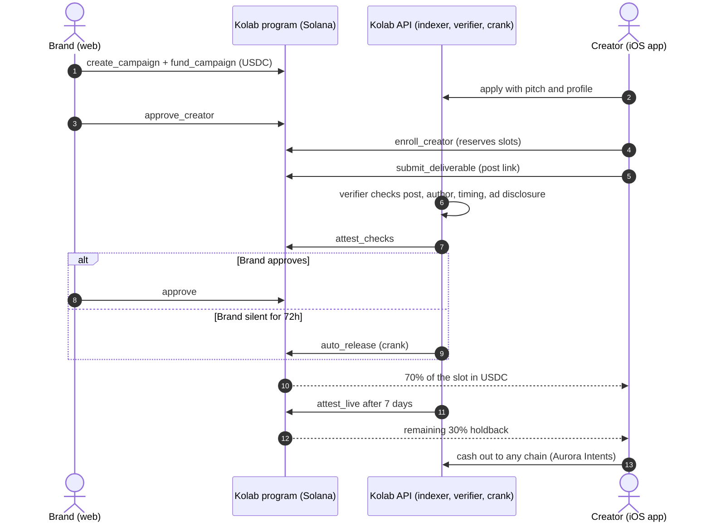
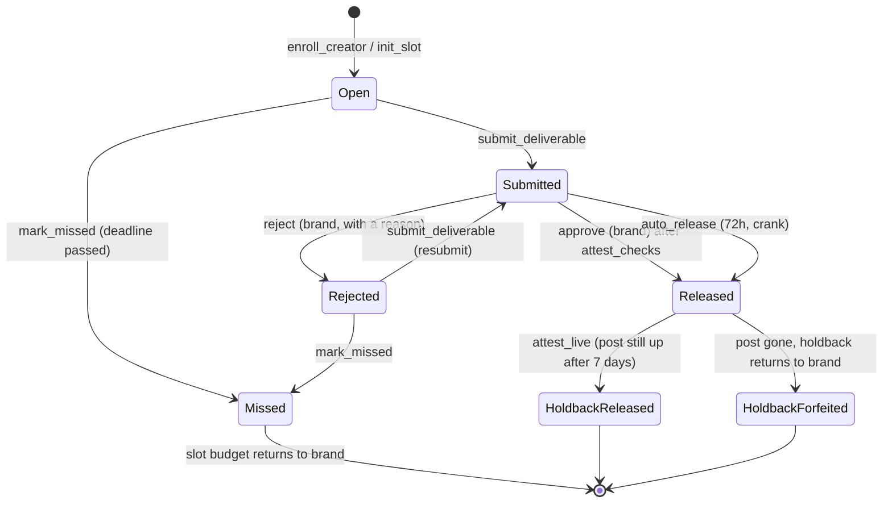
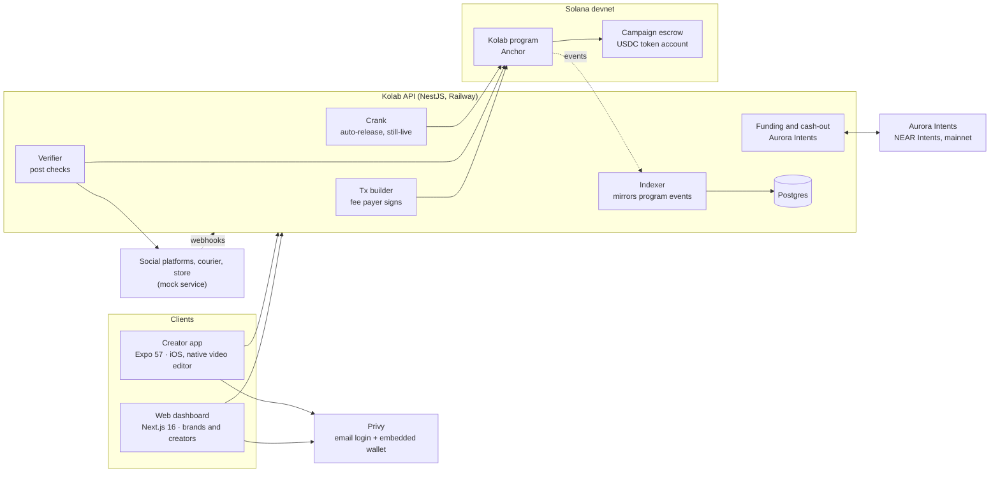
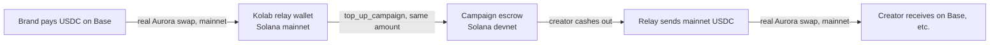

# Kolab

Kolab lets Southeast Asian online sellers hire micro-creators and pay them in USDC through an escrow program on Solana.

The brand locks the budget in the escrow before any work starts. When a creator delivers, an automated verifier checks the post, and the escrow pays out even if the brand never logs back in. Creators sign in with an email and get a wallet with no seed phrase. Kolab pays their network fees, and they can cash out to another chain.

| | |
|---|---|
| Live demo | https://kolab-web-eight.vercel.app (devnet, demo mode on) |
| API | https://api-production-0d06f.up.railway.app/health |
| Demo video | _[link to the walkthrough]_ |
| Program (devnet) | [`7hTBC9iCNxZ3pmfk1EHstbB4hmxu2iRrNMZ4UhhChQfv`](https://explorer.solana.com/address/7hTBC9iCNxZ3pmfk1EHstbB4hmxu2iRrNMZ4UhhChQfv?cluster=devnet) |
| Tracks | Best Consumer App on Solana · Aurora Intents |

## The problem

Kolab's creators have 1k to 20k followers and work in Malaysia, Indonesia, the Philippines and Thailand. They film first and hope the brand pays. Brands pay up front and hope the post goes up, stays up and carries the `#ad` disclosure.

With Kolab, the budget is locked before work starts:

- Creators can see the money exists before they film anything. They're paid within minutes of approval, or automatically after 72 hours if the brand doesn't respond.
- Brands only release money for a post that passed the checks. If the creator deletes the post within 7 days, the held-back 30% returns to the brand.
- Kolab charges brands 5% on released money and charges creators nothing.

## How it works



Each deliverable is a slot with its own on-chain state. Escrowed USDC moves only through these transitions, and Kolab can't move it any other way.



### Campaign types

| Type | How the creator gets paid |
|---|---|
| Per post | A fixed USDC rate per approved deliverable |
| Monthly package | A bundle of posts with one budget, released slot by slot |
| Per sale | The creator gets a voucher code. The store's signed webhook triggers `record_sale`, and the creator claims per confirmed sale |
| UGC | Content files for the brand's own channels, no holdback |

Any type can require shipping: the brand ships the product first (`mark_shipped`), the creator confirms receipt (`confirm_received`), then delivers.

## Architecture



### How Kolab uses Solana

Each campaign's budget sits in a USDC account owned by the program. The program enforces the release rules: brand approval, the 72-hour auto-release, the 70/30 holdback, the still-live check and per-sale claims. Kolab's database only mirrors program events through the indexer, so the chain is the source of truth.

Users never hold SOL, because Kolab's fee payer co-signs every transaction. Privy creates an embedded Solana wallet at email sign-up, so signing is a tap. A 10 USDC payout costs a fraction of a cent and lands in seconds, which makes small per-post and per-sale payouts practical.

### Funding and cash-out on other chains (Aurora Intents)

Brands can fund a campaign from USDC on other chains, and creators can cash out to the chain or token they use.



For this PoC the escrow runs on devnet, while the Aurora leg runs on mainnet with real quotes, deposit addresses, settlement and refunds. A relay wallet connects the two and is capped at 10 USDC per flow and per user per day. In production there's no relay: Intents Connect deposits into the mainnet program and calls `top_up_campaign`, which is wired up as `AURORA_MODE=aurora`. Local runs can use `AURORA_MODE=simulated`, which costs nothing.

## Features

Brands use the web dashboard to create, fund and publish campaigns, fund them from other chains, and ship products. They review applicants by niche, audience and track record, approve them on-chain, and review each submission with its check results.

Creators use the iOS app or the web. They sign up with an email, add channels and sample posts, find campaigns in Discover, apply and join. Each campaign has a brand kit and brief, AI hook ideas (Gemini, with a template fallback) and a native video editor for trimming, captions, music and an end card. Creators deliver, track earnings, withdraw, and cash out to other chains.

The verifier checks that the post exists, that its author matches the linked handle, that the timing fits the campaign, and that it carries the `#ad` disclosure.

In demo mode, the program's demo clock lets the Demo panel skip the 72-hour and 7-day windows, fire mock sales and mark parcels delivered.

Users can delete their account in the app, which App Store guideline 5.1.1(v) requires. Deletion is refused while money or work is still outstanding.

## Repo layout

| Path | What |
|---|---|
| `programs/kolab` | Anchor program: escrow, slots, approvals, sales, demo clock |
| `apps/api` | NestJS API: tx builder, indexer, verifier, crank, Aurora funding and cash-out |
| `apps/web` | Next.js dashboard for brands and creators |
| `apps/mobile` | Expo creator app with a native Swift video editor |
| `apps/mock` | Mock social platform (oEmbed), courier and store webhook |
| `packages/shared` | Types and zod schemas shared by every app |
| `packages/sdk` | Generated program client (Codama) |
| `packages/ai` | Gemini adapter for hooks and captions |
| `packages/ui` | Theme tokens |

## Run it locally

Prerequisites: Node 24 (`nvm use`), pnpm 12 (`corepack enable`), Docker, Rust (pinned in `rust-toolchain.toml`), Solana CLI 4.1.2, Anchor 1.2.1 (`avm use 1.2.1`), Xcode for the iOS app.

```bash
pnpm install
pnpm db:up                                   # Postgres on localhost:5433
cp apps/api/.env.example apps/api/.env       # fill PRIVY_*, keys, PROGRAM_ID, USDC_MINT
cp apps/web/.env.example apps/web/.env.local # fill NEXT_PUBLIC_PRIVY_APP_ID
cp apps/mobile/.env.example apps/mobile/.env # fill EXPO_PUBLIC_PRIVY_APP_ID / _CLIENT_ID
pnpm --filter @kolab/api exec prisma migrate deploy
pnpm --filter "./packages/*" build
```

```bash
pnpm dev                                     # packages (watch), mock, API :4000, web :3000
pnpm --filter @kolab/mobile ios              # build and install the iOS dev build
pnpm --filter @kolab/mobile start            # Metro for the installed dev build
```

Tests:

```bash
cargo test -p kolab                          # program tests (LiteSVM)
pnpm --filter @kolab/api test                # API tests
pnpm --filter @kolab/api devnet:flow         # every money path against devnet, ends with PASS 16/16
pnpm typecheck && pnpm lint
```

More detail: [architecture](docs/architecture.md) · [tech stack](docs/techstacks.md) · [workplan](docs/workplan.md).
