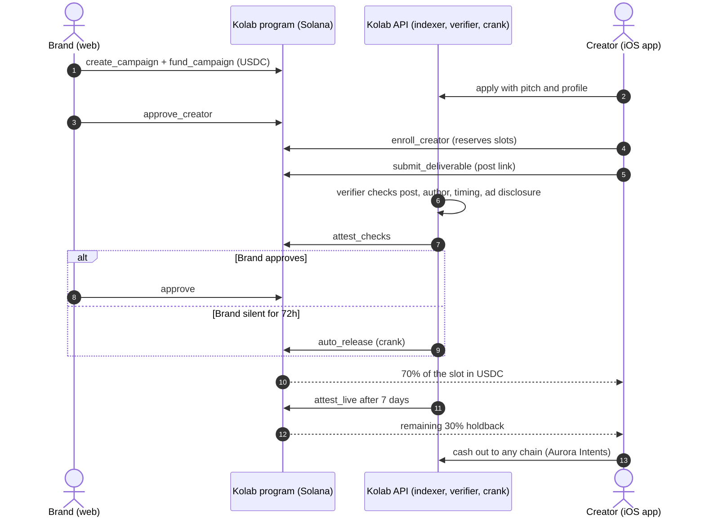
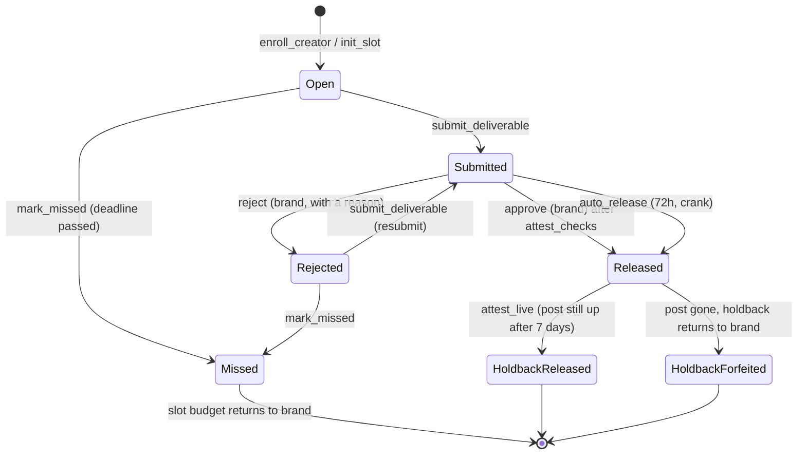
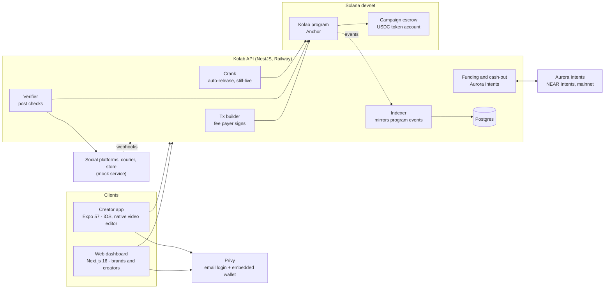
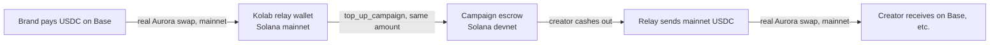

# Kolab

**Brands hire Southeast Asian micro-creators and pay them in USDC through an on-chain escrow on Solana.**

The brand locks the budget in a program-owned escrow before any work starts. Creators deliver, an automated verifier checks the post, and the escrow pays out by itself, even if the brand never logs back in. Creators sign in with an email, get a wallet without a seed phrase, never pay a network fee, and can cash out to the chain they actually use.

| | |
|---|---|
| **Live demo** | https://kolab-web-eight.vercel.app (devnet, demo mode on) |
| **API** | https://api-production-0d06f.up.railway.app/health |
| **Demo video** | _[link to the walkthrough]_ |
| **Program (devnet)** | [`7hTBC9iCNxZ3pmfk1EHstbB4hmxu2iRrNMZ4UhhChQfv`](https://explorer.solana.com/address/7hTBC9iCNxZ3pmfk1EHstbB4hmxu2iRrNMZ4UhhChQfv?cluster=devnet) |
| **Tracks** | Best Consumer App on Solana · Aurora Intents |

## The problem

Micro-creators in Malaysia, Indonesia and the Philippines (5k–100k followers) do most of the region's sponsored posts, and they get paid last: 30–90 day invoices, brands that go quiet after the post is live, and bank fees that eat small payouts. Brands, in turn, pay up front and hope the post goes up, stays up and carries the `#ad` disclosure.

Kolab replaces trust with an escrow:

- **Creators** see that the money exists before they film anything, and get paid within minutes of approval, or automatically after 72 hours if the brand doesn't respond.
- **Brands** only release money for a post that passed the checks, and get the held-back 30% back if the creator deletes it within 7 days.

## How it works



Every slot follows the same state machine on-chain. Nobody, including Kolab, can move escrowed USDC outside these transitions.



### Campaign types

| Type | How the creator gets paid |
|---|---|
| **Per post** | A fixed USDC rate per approved deliverable |
| **Monthly package** | A bundle of posts with one budget, released slot by slot |
| **Per sale** | The creator gets a voucher code. The store's signed webhook triggers `record_sale`, and the creator claims per confirmed sale |
| **UGC** | Content files for the brand's own channels, no holdback |

Any type can **require shipping**: the brand ships the product first (`mark_shipped`), the creator confirms receipt (`confirm_received`), then delivers.

## Architecture



### Where Solana matters

- **The escrow is the product.** Budgets sit in a program-owned USDC account per campaign. Release rules (approval, the 72-hour auto-release, the 70/30 holdback, the still-live check, per-sale claims) are enforced by the program, not by Kolab's database.
- **Gasless for users.** Kolab's fee payer co-signs every transaction, so brands and creators never hold SOL.
- **Wallets without crypto UX.** Privy creates an embedded Solana wallet at email sign-up. Users sign with a tap.
- **Fast, cheap settlement.** A 10 USDC payout costs a fraction of a cent and lands in seconds, which makes per-post and per-sale payouts to small creators viable.
- **The database is a mirror.** The indexer rebuilds campaign, enrollment and slot state from program events, so the chain is the source of truth.

### Aurora Intents: any-chain in, any-chain out

Brands can fund a campaign from USDC on other chains, and creators can cash out to the chain or token they use.



To be upfront: the escrow runs on **devnet** for this PoC, and the Aurora leg is **live on mainnet** with real quotes, deposit addresses, settlement and refunds. A small relay wallet bridges the two, capped at 10 USDC per flow and per user per day. In production the relay goes away: Intents Connect deposits straight into the mainnet program and calls `top_up_campaign`, which is already wired as `AURORA_MODE=aurora`. A fully simulated mode (`AURORA_MODE=simulated`) is available for free local runs.

## What's in the box

- **Brand dashboard (web):** create, fund and publish campaigns; review applicants by niche, audience and track record; approve on-chain; review submissions with their check results; ship products; fund from any chain.
- **Creator app (iOS) and web:** email sign-up, profile with channels and samples, Discover, apply, join, brand kit and brief, AI hook ideas (Gemini, with template fallback), a native video editor (trim, captions, music, end card), deliver, earnings, withdraw and cash out to any chain.
- **Automated verifier:** checks the post exists, the author matches the linked handle, the timing fits the campaign, and the `#ad` disclosure is present.
- **Demo mode:** a demo-clock build of the program lets the Demo panel skip the 72-hour and 7-day windows, fire mock sales and mark parcels delivered.
- **Account deletion** that refuses while money or work is outstanding (App Store 5.1.1(v)).

## Repo layout

| Path | What |
|---|---|
| `programs/kolab` | Anchor program: escrow, slots, approvals, sales, demo clock |
| `apps/api` | NestJS API: tx builder, indexer, verifier, crank, Aurora funding and cash-out |
| `apps/web` | Next.js dashboard for brands and creators |
| `apps/mobile` | Expo creator app with a native Swift video editor |
| `apps/mock` | Mock social platform (oEmbed), courier and store webhook |
| `packages/shared` | Types and zod schemas shared by every app |
| `packages/sdk` | Generated program client (Codama) |
| `packages/ai` | Gemini adapter for hooks and captions |
| `packages/ui` | Theme tokens |

## Run it locally

Prerequisites: Node 24 (`nvm use`), pnpm 12 (`corepack enable`), Docker, Rust (pinned in `rust-toolchain.toml`), Solana CLI 4.1.2, Anchor 1.2.1 (`avm use 1.2.1`), Xcode for the iOS app.

```bash
pnpm install
pnpm db:up                                   # Postgres on localhost:5433
cp apps/api/.env.example apps/api/.env       # fill PRIVY_*, keys, PROGRAM_ID, USDC_MINT
cp apps/web/.env.example apps/web/.env.local # fill NEXT_PUBLIC_PRIVY_APP_ID
cp apps/mobile/.env.example apps/mobile/.env # fill EXPO_PUBLIC_PRIVY_APP_ID / _CLIENT_ID
pnpm --filter @kolab/api exec prisma migrate deploy
pnpm --filter "./packages/*" build
```

```bash
pnpm dev                                     # packages (watch), mock, API :4000, web :3000
pnpm --filter @kolab/mobile ios              # build and install the iOS dev build
pnpm --filter @kolab/mobile start            # Metro for the installed dev build
```

Tests:

```bash
cargo test -p kolab                          # program tests (LiteSVM)
pnpm --filter @kolab/api test                # API tests
pnpm --filter @kolab/api devnet:flow         # every money path against devnet, ends with PASS 16/16
pnpm typecheck && pnpm lint
```

More detail: [architecture](docs/architecture.md) · [tech stack](docs/techstacks.md) · [workplan](docs/workplan.md).
