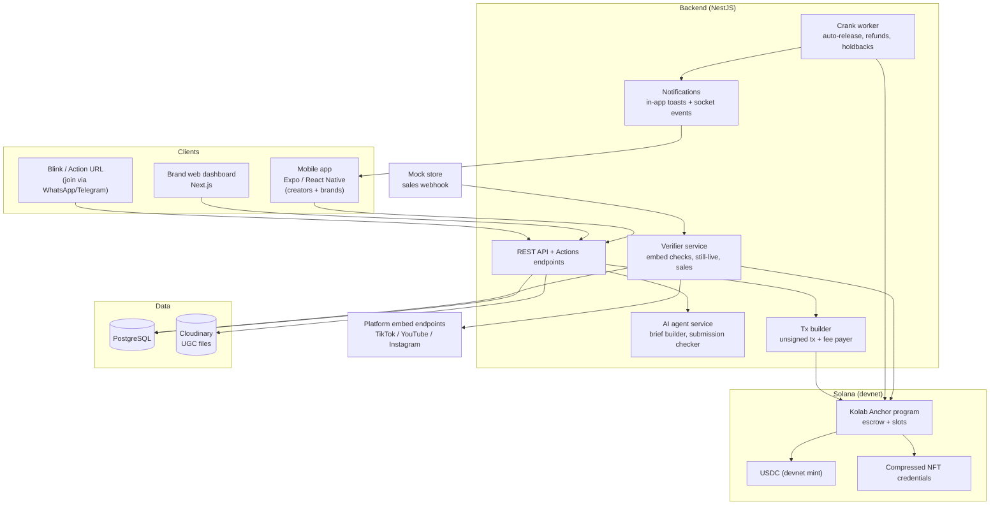
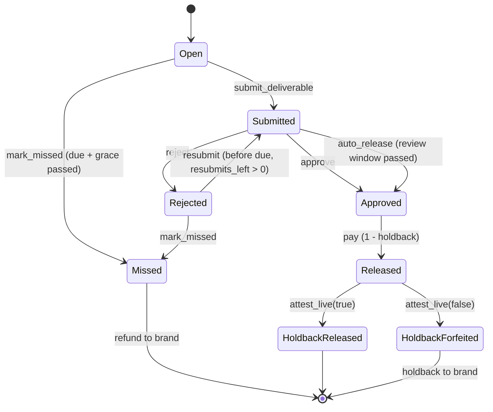
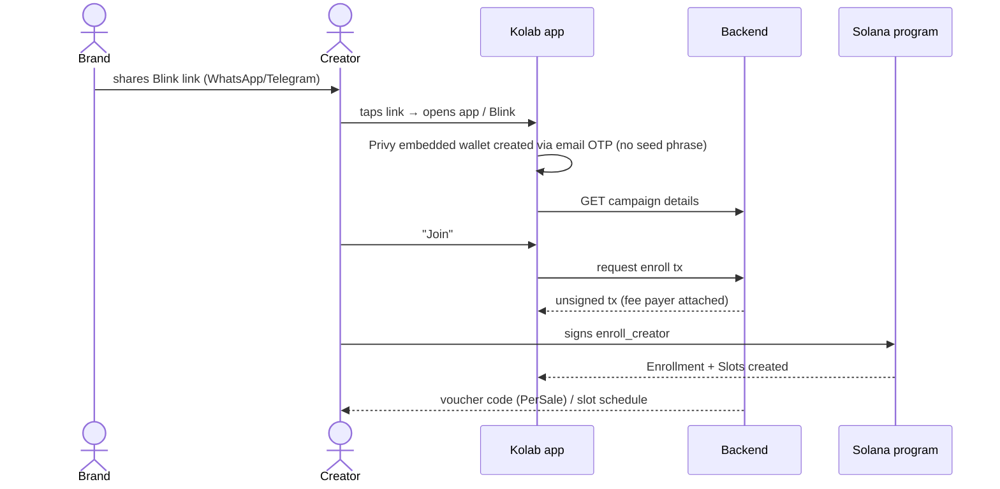
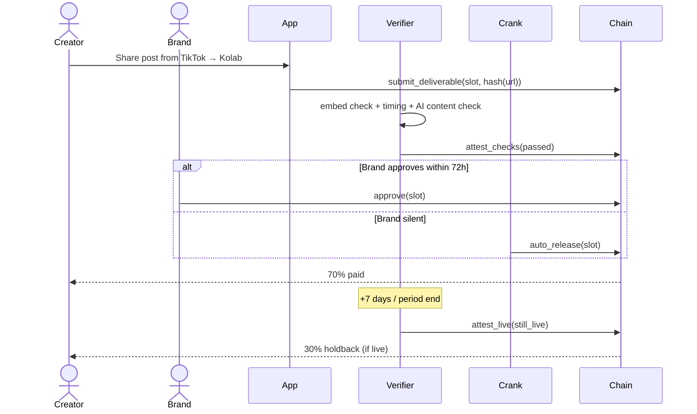

# Kolab — Architecture (Draft v0.8)

> Status: **working draft** — not final. Open decisions are marked **[OPEN]** and collected in §11.
> Target: Solana hackathon, *Best Consumer App on Solana* track (devnet).

---

## 1. Product in one paragraph

Kolab is a mobile-first app where Southeast Asian online sellers (brands) hire micro-creators for content and sales campaigns, and pay them in USDC through an on-chain escrow. Every campaign is broken into small, verifiable deliverables ("slots"). Money is locked up front so creators know it exists, and released slot by slot as work is verified — automatically if the brand goes quiet, back to the brand if the creator doesn't deliver. Completed work builds a portable, on-chain reliability record for each creator.

### Users
| Role | Device | Core jobs |
|---|---|---|
| **Brand** (Shopee / TikTok Shop / Lazada seller) | Mobile app or web dashboard | Create campaign, fund vault, review submissions, renew/cancel packages |
| **Creator** (1k–20k followers, MY/ID/PH/TH) | Mobile app (primary) | Join via link, submit deliverables, get paid, build track record |
| **Verifier service** (backend) | — | Automated checks, attestations, time-based cranks |

### Campaign types
| Type | Unit of payment | Verification |
|---|---|---|
| **Per-post** | One payment per approved post | Link submission + auto checks + brand approval |
| **Monthly package** | Schedule of slots (e.g. 8 posts + 1 UGC / month) | Same as per-post, per slot, plus still-live holdback |
| **Per-sale** | Fixed amount per confirmed sale | Unique voucher code / link per creator, sales attested by verifier |
| **UGC delivery** | One payment per delivered file | File hash recorded on-chain + brand approval |

### 1.1 Cross-border product seeding
Campaigns run across MY / ID / PH / TH, provided the brand can ship internationally. Most UGC needs the creator to hold the product, so shipping is part of the campaign:

1. Brand sets **ships-to countries**, declared product value, and who pays duties (default: brand, delivered duty paid). Creators only see campaigns that can ship to them.
2. Creator enrolls and shares a shipping address — stored encrypted **off-chain**, visible only to that brand, deleted 30 days after the campaign ends. Never on-chain.
3. Brand ships and enters courier + tracking number → `mark_shipped` records a hash of the tracking ref on-chain.
4. Creator taps "Received" → `confirm_received`. If the creator does nothing, it auto-confirms after the shipping window (default 14 days domestic, 21 days cross-border) unless they reported a problem.
5. **Slot due dates start from the received date**, so slow customs never makes a creator "late".
6. Not received → `report_not_received` → brand can reship or cancel; all slots refunded to brand; no reputation penalty for the creator.
7. Product is kept by the creator by default (gifted); "return after shoot" is an optional campaign setting.

### 1.2 Pricing & business model

**How classic UGC / influencer platforms charge** (public 2026 comparisons — verify before quoting in the pitch):

| Platform | Brand pays | Creator pays | Notes |
|---|---|---|---|
| Collabstr | Marketplace fee (~10% of bookings) + optional pro plan from ~US$249/mo | — | Escrow included |
| Influee | Monthly subscription + 10% marketplace fee | — | AI matching, global |
| Insense | ~US$400–500/mo subscription + per-creator fees | — | Strong for whitelisted ads |
| Billo | From ~US$99 per video | — | Managed, video-first, US-focused |
| Youdji | 0% | 20% commission | Shifts cost to creators |
| Partipost (SEA) | Creator payouts + platform fees, shown at budget setup | — | Micro/nano focus in SEA |
| Agencies | Typically a management retainer or markup | — | Manual sourcing and chasing |

**Kolab pricing (proposal)**
- **Brands:** no subscription. **5% fee only on money actually released to creators** — missed, refunded and forfeited amounts are fee-free. Taken by the program at release into a treasury account, visible on-chain.
- **Creators:** 0% commission — they receive their full quoted rate. Any cash-out (off-ramp) fee is the partner's and shown separately.
- **AI briefs and checks:** included up to a monthly quota; heavy use billed per call.
- **Data revenue:** x402 creator search, reliability lookups, checks and UGC licences (§5.5).

**Why Kolab can be cheaper**
| Cost line at classic platforms | Kolab |
|---|---|
| Card / cross-border wire / FX fees on payouts | Stablecoin settlement on Solana costs fractions of a cent |
| Account managers chasing deliverables and payments | Escrow + slots + cranks do it automatically |
| Manual content review | AI checker pre-screens; brand approves in one tap |
| Payment disputes / chargebacks | Funds pre-locked; outcomes enforced by the program |
| Subscription to cover fixed overhead | Pay only on delivered value |

Example: a brand books 10 nano creators × RM500 = RM5,000. Kolab fee = RM250 (only if all slots are delivered). A 10% marketplace = RM500, and subscription platforms add a monthly fee on top.

---

## 2. System overview



### Design rules (carried over and non-negotiable)
1. **Non-custodial.** Users sign their own transactions from a Privy embedded wallet (email OTP login). The backend builds unsigned transactions; it never holds user keys.
2. **Money rules live on-chain.** Release, refund, auto-release and holdback logic is enforced by the program, not the backend.
3. **The AI never decides wallets or amounts.** The agent proposes briefs and flags issues; identity, amounts and recipients come from authenticated session data and on-chain state.
4. **No SOL needed for users.** All user transactions use a sponsored fee payer.
5. **No scraping.** Platform checks use official embed/oEmbed endpoints only.

---

## 3. Tech stack

| Layer | Choice | Notes |
|---|---|---|
| Mobile | Expo (React Native), expo-router | Share-extension target for "Share → Kolab" from TikTok/Instagram |
| Brand web | Next.js | Campaign setup, bulk review |
| Backend | NestJS (TypeScript), PostgreSQL | Job queue for verifier + crank: pg-boss (Postgres only) |
| On-chain | Anchor program (Rust), SPL Token, USDC devnet | |
| Wallet | Privy embedded Solana wallet (`@privy-io/expo` on mobile, React SDK on dashboard), email OTP login | Chosen for the hackathon; passkeys / other providers revisited later |
| Fee sponsorship | Backend fee-payer keypair (Kora optional later) | Sponsors gas for all user txs |
| Credentials | Compressed NFTs (Bubblegum) | One per completed slot/package **[OPEN: per slot vs per package]** |
| Sharing | Solana Actions / Blinks | Campaign join link |
| AI | LLM via tool-calling | Brief builder, submission checker, fraud flags |
| Storage | Cloudinary (`authenticated` delivery type, signed read URLs) | UGC files; SHA-256 recorded on-chain |
| Push | In-app toasts + socket events for the hackathon; Expo push post-hackathon | Due dates, approvals, payouts |

---

## 4. On-chain program design

### 4.1 Accounts

```
Campaign            PDA ["campaign", brand, campaign_id]
  brand: Pubkey
  campaign_type: PerPost | Monthly | PerSale | Ugc
  mint: Pubkey                 // payout token — must be on the stablecoin allowlist (§4.5)
  vault: Pubkey                // token account owned by Campaign PDA
  verifier: Pubkey             // attestor authority (backend key)
  status: Draft | Active | Cancelling | Closed
  period_index: u16            // monthly renewals: 0, 1, 2…
  start_ts, end_ts: i64
  review_window_secs: i64      // default 72h → auto-release
  grace_secs: i64              // default 48h after due → missable
  holdback_bps: u16            // default 3000 (30%) released on still-live
  fee_bps: u16                 // platform fee on released amounts only (default 500 = 5%)
  treasury: Pubkey             // fee recipient
  requires_shipping: bool
  shipping_window_secs: i64    // auto-confirm receipt after this (14d / 21d)
  notice_secs: i64             // cancellation notice, default 7d
  per_sale_amount: u64         // PerSale only
  max_creators: u16
  total_funded, total_committed, total_released, total_refunded: u64

Enrollment          PDA ["enroll", campaign, creator]
  creator: Pubkey
  status: AwaitingShipment | InTransit | Active | NotReceived | Cancelled | Completed
  tracking_hash: [u8; 32]      // hash(courier + tracking ref)
  shipped_ts, received_ts: i64
  slot_count: u16
  voucher_hash: [u8; 32]       // PerSale: hash of creator's code
  sales_accrued: u64           // PerSale: unclaimed earnings
  earned_total: u64

Slot                PDA ["slot", enrollment, period_index, slot_idx]
  kind: Post | Ugc
  due_ts: i64                  // product campaigns: offset from Enrollment.received_ts
  amount: u64                  // full slot value
  status: Open | Submitted | Approved | Rejected | Released
          | HoldbackReleased | Missed | HoldbackForfeited
  content_hash: [u8; 32]       // hash(post URL) or hash(UGC file)
  submitted_ts, decided_ts: i64
  resubmits_left: u8           // default 1
  checks_passed: bool          // set by verifier attestation
```

**[OPEN]** Account rent: one `Slot` account per deliverable is simple but costs rent per slot. Alternative: pack up to N slots into a fixed array on `Enrollment`. Decide after estimating typical slots per creator.

### 4.2 Instructions

| Instruction | Signer | Effect |
|---|---|---|
| `create_campaign` | Brand | Initialise Campaign + vault |
| `fund_campaign` | Brand | Transfer USDC into vault |
| `approve_creator(creator)` | Brand | Create Approval PDA `["approval", campaign, creator]`; `creator = default` is an open invite (anyone may join) |
| `revoke_approval` | Brand | Close an unused approval |
| `enroll_creator` | Creator, **requires an Approval** (own or open invite) | Create Enrollment + Slots per schedule; commit funds |
| `mark_shipped(tracking_hash)` | Brand | Enrollment → InTransit |
| `confirm_received` | Creator, or **anyone** after shipping window | Enrollment → Active; sets `received_ts`; slot due dates start |
| `report_not_received` | Creator (before window ends) | Enrollment → NotReceived; brand reships (back to InTransit) or cancels → refund, no creator penalty |
| `submit_deliverable(slot, content_hash)` | Creator | Slot → Submitted; starts review window |
| `attest_checks(slot, passed)` | Verifier | Records automated check result |
| `approve(slot)` | Brand | Release `amount × (1 − holdback)` to creator |
| `reject(slot, reason_code)` | Brand | Slot → Rejected; creator may resubmit before due if `resubmits_left > 0` |
| `auto_release(slot)` | **Anyone** (crank) | If Submitted and review window elapsed → treat as approved |
| `mark_missed(slot)` | **Anyone** (crank) | If Open/Rejected and `due + grace` elapsed → refund slot to brand |
| `attest_live(slot, still_live)` | Verifier | Release holdback to creator, or forfeit it back to brand |
| `record_sale(enrollment, amount, ref)` | Verifier | PerSale: increase `sales_accrued` (idempotent on `ref`) |
| `claim_sales(enrollment)` | Creator | Transfer accrued sales earnings |
| `request_cancel` | Brand or creator | Starts notice period; future slots after notice → refundable |
| `renew_period` | Brand | Fund + create next period's slots (`period_index + 1`) |
| `close_campaign` | Brand (after end) | Refund uncommitted remainder, close accounts |

Permissionless cranks (`auto_release`, `mark_missed`) mean creators are protected even if Kolab's backend goes down — anyone, including the creator, can trigger them.

### 4.3 Slot state machine



### 4.4 Trust model
- The **verifier** key is a centralised attestor for facts the chain can't see (post exists, still live, sales happened). This is an acknowledged trust assumption for the hackathon.
- Brand protections: missed slots and deleted posts return money automatically.
- Creator protections: funds pre-locked; auto-release if brand is silent; cranks are permissionless.
- **[OPEN]** Post-hackathon: multiple attestors / brand-run attestor for per-sale data; dispute window before `attest_live(false)` is final.

### 4.5 Supported tokens
- **Vault (escrow) token:** stablecoins only, from an allowlist kept in a program config account. Launch: USDC; later USDT, PYUSD, XSGD (if live on Solana). Reason: slot amounts are promises of fixed value over weeks; a volatile token would change what the creator earns between funding and payout.
- **Pay in with anything:** the brand can fund with SOL or any liquid SPL token. The app swaps it to the campaign's stablecoin at funding time (e.g. via a Jupiter swap in the same transaction), so the vault always holds the stablecoin.
- **Cash out as anything:** at claim time the creator can choose to receive SOL or another token; the payout is swapped in the claim transaction. The creator takes the price risk only from the moment they choose it.
- **Excluded:** Token-2022 mints with transfer fees or transfer hooks (they break exact slot amounts) and tokens with no reliable swap liquidity.
- **Native SOL:** handled as wrapped SOL only when it's a swap input/output, never as a vault token.

---

## 5. Off-chain services

### 5.1 Verifier service
1. **Existence check** — official embed/oEmbed endpoint for the submitted URL (TikTok, YouTube public; Instagram needs a Meta app token **[OPEN]**). Confirms public post, author handle matches the creator's linked handle.
2. **Timing check** — post timestamp inside the slot window.
3. **Content check** (AI) — product mentioned, required hashtag/voucher code present, paid-partnership disclosure present. Output stored in Postgres; pass/fail attested on-chain via `attest_checks`.
4. **Still-live checks** — re-run existence check at +7 days and at period end → `attest_live`.
5. **Sales ingestion** — webhook from store (mock in demo) → match voucher → `record_sale` (idempotent by order ref).

### 5.2 Crank worker
- Scans for Submitted slots past review window → `auto_release`.
- Scans for Open/Rejected slots past `due + grace` → `mark_missed`.
- Schedules still-live checks.
- Fee payer covers crank transactions.

### 5.3 AI agent service
| Function | Input | Output |
|---|---|---|
| Brief builder | Product link + budget | Draft brief, suggested campaign type, per-creator rate, slot schedule |
| Submission checker | Caption / frame / transcript | Pass/fail per rule + explanation for brand |
| Fraud flags | Creator profile stats | Warnings (sudden follower spikes, reused content) |
| Chat front door | Natural language | Tool calls into API (never sets wallet or amount) |

Multilingual: English, Bahasa Malaysia/Indonesia, Tagalog, Thai.

### 5.4 Notifications
Hackathon: in-app toasts driven by socket events; Expo push post-hackathon. Notify on: slot due soon, submission received, approved/rejected, payout received, auto-release triggered, slot missed, renewal reminder.

### 5.5 x402 surfaces (machine-paid endpoints)
x402 is **not** used for escrow payouts — escrow is conditional, time-based release; x402 is pay-for-a-resource over HTTP. It is used wherever software pays per request:

| Endpoint | Payer | Price model | Value |
|---|---|---|---|
| `GET /x402/creators/search` (niche, country, on-time rate, follower band) | Brand AI agents, agencies, growth tools | `exact` per query | Agent-driven creator discovery |
| `GET /x402/creators/{id}/reliability` | Other platforms, agencies | `exact` per lookup | Monetises the on-chain track record; creator gets a revenue share |
| `POST /x402/checks/content` (disclosure, product mention, language) | Kolab's own verifier + third-party agents | `upto` (LLM cost varies) | Same checker sold as a service |
| `POST /x402/checks/audience` (fake-follower / reused-content signals) | Brand agents before hiring | `upto` | Pre-hire due diligence |
| `GET /x402/ugc/{id}/licence` | Other brands / agents wanting existing UGC | `exact`, split to creator | Creators earn again from delivered content |

Rules:
- Settlement in USDC on Solana via a facilitator; `upto` for variable-cost AI checks; payment channels for high-volume agent callers **[OPEN]**.
- Fulfil only after the required confirmation level; idempotency key from payment payload + request hash, so retries never double-charge.
- Paid but check failed to run (model/timeout/upstream error) → automatic refund or credit; a negative verdict is still a delivered result.
- Revenue split for reliability lookups and UGC licences paid to the creator's wallet at settlement.

### 5.6 Creator selection & reputation

Brands should be able to choose creators on the same criteria agencies use, with each number labelled by **how it is known**:

| Badge | Source | Example |
|---|---|---|
| **Self-declared** | Creator typed it | Rate card, niches, languages |
| **Platform-verified** | Pulled via official API / OAuth insights or embed data | Followers, avg views, audience country split |
| **Kolab-verified** | Derived from on-chain Kolab history | On-time rate, completion, sales generated |

#### Criteria (classic influencer + UGC)

| Group | Criteria | Notes |
|---|---|---|
| **Reach** | Follower tier (nano 1k–10k, micro 10k–100k), average views (last 10 posts), view-to-follower ratio | Not required for pure UGC creators |
| **Engagement** | Engagement rate = (likes + comments + shares) ÷ views (and ÷ followers), comment quality | Comment quality via AI sample (real conversation vs emoji spam) |
| **Audience fit** | Audience country, age band, gender split, language | Must match campaign target market |
| **Authenticity** | Suspected fake-follower %, follower growth curve (spikes), engagement anomalies, reused content | Shown as risk flags, not a single verdict |
| **Content quality** | Production quality, hook strength (first 3s), clarity of product demo, aesthetic fit | AI-assisted scoring of portfolio + brand's own rating |
| **Niche & brand fit** | Categories, past brand collabs, competitor conflicts, brand safety (no controversial content) | Competitor conflict = recent paid post for a competing brand |
| **UGC capability** | Formats (unboxing, testimonial, tutorial, voice-over, faceless), on-camera presence, languages, turnaround time, usage rights offered | Key for UGC-only campaigns |
| **Performance** | Past Kolab results: CTR/sales per post, cost per sale, cost per 1k views | Kolab-verified only |
| **Reliability** | On-time rate, completion rate, avg revisions, response time, deleted-post rate, disputes | Kolab-verified, on-chain |
| **Commercial** | Rate per post / per month / per UGC asset, exclusivity, usage-rights duration | Self-declared |
| **Compliance** | Disclosure history (#ad usage), category claim rules (e.g. health/cosmetic claims) | AI checker history |

#### Kolab Score (transparent, campaign-weighted)
Score = weighted sum of five pillars, each 0–100, always shown with its breakdown:

| Pillar | Per-post | Monthly | Per-sale | UGC-only |
|---|---|---|---|---|
| Fit (niche + audience match to *this* campaign) | 25% | 20% | 20% | 20% |
| Quality (content + engagement quality) | 25% | 20% | 15% | 40% |
| Performance (past results) | 15% | 15% | 40% | 10% |
| Reliability (on-chain history) | 20% | 35% | 15% | 25% |
| Authenticity (audience risk) | 15% | 10% | 10% | 5% |

Brands can adjust weights; defaults depend on campaign type. Fit is computed per campaign, so the same creator ranks differently for different briefs.

#### Two-sided reputation
- **Creators rate brands** after each slot/period: paid on time (on-chain), approval speed, rejection rate, brief clarity. Shown to creators before they join.
- **Brands rate creators** with structured 1–5 ratings: brief adherence, quality, communication. Stored off-chain; hash + averages included in the creator's credential.

#### Anti-gaming
- Only campaigns funded above a minimum value and from distinct brands count toward reputation.
- Ratings weighted by the rater's own reputation and account age; a brand–creator pair counts once per period.
- Self-dealing detection: shared wallets, funding sources, or devices between brand and creator → excluded.
- Reliability uses on-chain outcomes (released / missed / forfeited), which ratings cannot override.

#### Cold start
- New creators: portfolio upload + platform-verified stats + AI quality score; shown with a "New" badge instead of a low score.
- **Trial slot**: brands can offer a single low-value slot before a monthly package; completion seeds reliability.

#### Fairness
- Scores use performance, audience and behaviour data only — never the creator's own personal attributes (race, religion, gender, etc.).
- Audience demographics are used only for market fit, and the breakdown is visible to the creator.

---

## 6. Key flows

### 6.1 Creator joins via Blink (mobile)



### 6.2 Monthly slot lifecycle



### 6.3 Per-sale
Store webhook → verifier matches voucher → `record_sale` → creator sees accrual live → `claim_sales` anytime.

---

## 7. Off-chain data model (PostgreSQL, sketch)

```
users            id, role, display_name, wallet_pubkey, locale, created_at
social_accounts  id, user_id, platform, handle, verified_at
campaigns        id, onchain_pubkey, brand_id, type, title, brief_md, rules_json, status
enrollments      id, onchain_pubkey, campaign_id, creator_id, voucher_code
slots            id, onchain_pubkey, enrollment_id, idx, period_index, due_at, amount, status
submissions      id, slot_id, url, file_key, content_hash, submitted_at
check_results    id, submission_id, check_type, passed, details_json, attested_tx
sales            id, enrollment_id, order_ref (unique), amount, recorded_tx
credentials      id, creator_id, asset_id, summary_json
creator_profiles id, user_id, niches[], languages[], formats[], rate_card_json, usage_rights_json
audience_snaps   id, social_account_id, followers, avg_views, eng_rate, country_split_json,
                 age_gender_json, authenticity_flags_json, source (self|platform), captured_at
portfolio_items  id, creator_id, url_or_file_key, format, ai_quality_json
ratings          id, slot_id, rater_id, ratee_id, direction (brand→creator|creator→brand),
                 scores_json, comment, weight
score_snapshots  id, creator_id, campaign_id (nullable), pillars_json, total, computed_at
brand_profiles   id, user_id, category, on_time_rate, avg_approval_hours, rejection_rate
notifications    id, user_id, type, payload_json, sent_at
```

On-chain state is the source of truth for money; Postgres is an index + content store, rebuilt from program events if needed.

---

## 8. Mobile app structure (Expo)

```
app/
  (auth)/            Privy email OTP onboarding (embedded wallet)
  (creator)/
    home             active slots, due dates, earnings
    campaigns        discover / joined
    slot/[id]        submit, status, resubmit
    profile          credentials, reliability score
  (brand)/           post-hackathon (brand uses the web dashboard for the hackathon)
    campaigns        list, create (AI brief builder)
    review           submission queue with check badges
    package/[id]     slot grid, renew, cancel
  wallet             USDC balance + local-currency display
share-extension/     receive URL from TikTok/Instagram share sheet
```

---

## 9. Hackathon scope

| Build for real | Simulate |
|---|---|
| Anchor escrow: create, fund, enroll, submit, approve, reject, auto_release, mark_missed, attest_live, record_sale, claim_sales | Store sales feed (mock webhook) |
| Privy embedded wallet (email OTP) + fee sponsorship | Fiat on-ramp / off-ramp (show widget, devnet faucet funding) |
| Blink join flow | Instagram checks (TikTok/YouTube embed checks real if time permits) |
| Monthly package with 4 slots | Time travel for review window/grace (demo clock flag on devnet) |
| AI brief builder + submission checker | |
| Credential mint on completion | |

### Demo script (target 3 min)
1. Brand pastes product link → AI drafts a 4-slot monthly package → funds vault (explorer link).
2. Creator joins from a WhatsApp Blink → Privy wallet via email OTP in seconds.
3. Slot 1: submitted → approved → 70% paid.
4. Slot 2: brand silent → clock advanced → auto-release.
5. Slot 3: not delivered → missed → refunded to brand.
6. Slot 4: post deleted → still-live check fails → holdback returns to brand.
7. Per-sale side campaign: 3 mock sales accrue → creator claims.
8. Creator profile shows new credential and "3/4 on time".

### 9.1 Local presentation setup (one Mac)

```
┌──────────────────────────┬──────────────────────────────┬─────────────────────┐
│ iOS Simulator            │ Browser: brand dashboard     │ Browser: demo panel │
│ Creator app (dev build)  │ localhost:3000               │ localhost:3000/demo │
└────────────┬─────────────┴──────────────┬───────────────┴──────────┬──────────┘
             │        HTTP + WebSocket    │                          │
             └──────────────► NestJS API localhost:4000 ◄────────────┘
                                   │
            ┌──────────────────────┼─────────────────────────┐
            ▼                      ▼                         ▼
     Postgres (Docker)    Mock platform server      Solana: devnet (primary)
                          localhost:4100            or local validator :8899 (offline fallback)
                          (fake TikTok embeds,
                           toggle "deleted",
                           fake store sales)
```

**Networking**
- The iOS Simulator shares the Mac's network, so `http://localhost:4000` works directly from the app. (Android emulator would need `10.0.2.2`; a physical phone needs the Mac's LAN IP.)
- Config via `EXPO_PUBLIC_API_URL` and `EXPO_PUBLIC_RPC_URL`; switch profiles with `.env.demo-sim`, `.env.demo-device`.
- Run as an Expo **dev build** (`npx expo run:ios`), not Expo Go — needed for native modules (wallet, share extension).

**Live sync between phone and dashboard**
- Backend pushes events over WebSocket (`slot.submitted`, `slot.released`, `sale.recorded`, …) to both the app and the dashboard.
- Both clients also subscribe to the relevant program accounts via RPC `accountSubscribe`, so the UI updates the moment a transaction confirms, whoever sent it.
- In-app toast for payouts instead of relying on remote push; optional real banner via `xcrun simctl push booted <bundle-id> payload.apns`.

**Demo control panel (`/demo`, dev builds only)**
| Button | Effect |
|---|---|
| Reset demo | Re-seed DB + chain: brand, 2 creators, funded campaign, 4-slot package |
| Advance clock +72h / +7d | Shifts the demo clock (see below) and runs the crank |
| Mark parcel delivered | Simulates courier delivery → `confirm_received` → slot clock starts |
| Fire mock sale | Store webhook → verifier → `record_sale` |
| Delete creator post | Mock embed server returns 404 → still-live check fails |
| Run crank now | Executes auto_release / mark_missed immediately |

**Demo clock**
- The program reads time through a helper: `now = Clock::get() + config.demo_offset`. The offset and its setter exist only when built with the `demo-clock` Cargo feature; the devnet/mainnet build without the feature cannot shift time.
- Backend crank and verifier use the same offset so on-chain and off-chain agree.

**Submissions in the simulator**
- No TikTok app in the simulator: creator submits by sharing a mock post URL from Safari to the Kolab share extension (same flow as on a real phone), or by pasting it.
- Mock platform server serves oEmbed-shaped responses for those URLs.

**Wallet / signing**
- Passkeys need an associated domain served over HTTPS, so they won't work against plain localhost. Two modes:
  - **Devnet mode (primary):** Privy embedded wallet with email OTP login (no associated domain needed) + devnet RPC; backend still on localhost. Requires internet.
  - **Offline mode (fallback):** local validator + `DEMO_SIGNER=1`, which stores a generated keypair in the device's secure storage. Clearly labelled "demo signer" in the UI.
- Fee payer: backend-held devnet keypair (or local Kora) sponsors all user transactions.

**Showing the chain**
- Devnet: normal Solana Explorer links.
- Local validator: Solana Explorer with custom cluster `?cluster=custom&customUrl=http://localhost:8899`.
- Dashboard shows the tx signature for every money event, linked to the explorer.

**Scripts**
```
pnpm demo:up        # docker (postgres), mock server, API, dashboard
pnpm demo:chain     # deploy program (demo-clock feature) + create test USDC mint
pnpm demo:seed      # brand, creators, campaign, funded vault
pnpm demo:reset     # wipe + chain + seed
npx expo run:ios    # creator app in simulator
```

**Recording the required 2–4 min video**
- `xcrun simctl io booted recordVideo demo.mp4` for the phone, plus QuickTime screen recording for the full three-pane view.
- The submission still deploys the program to devnet and documents both modes in the README.

**Environments** (detail in `workplan.md` §0.3)
- Two environments, both on **Solana devnet**, each with its own program ID, fee-payer/verifier keypairs, database and Cloudinary folder.
- **Local demo (presenting Mac):** demo-clock program build, `DEMO_MODE=1`, web `localhost:3000`, API `localhost:4000`, mock `localhost:4100`, Postgres in Docker, creator app in the iOS Simulator.
- **Hosted (judges):** non-demo program build (the ID quoted in README), `DEMO_MODE=0`; web on **Vercel**, API + workers, mock server and Postgres on **Railway**.
- `demo:chain --target local-demo|hosted` writes the right program ID, mint and tree per environment.

---

## 10. Risks & mitigations

| Risk | Mitigation |
|---|---|
| Fiat cash-out needs licensing per country | Stay non-custodial; cash-out via licensed partner integration post-hackathon |
| Platform terms (TikTok, Instagram, Shopee) | Official embed endpoints only; no scraping or automated engagement |
| Ad-disclosure rules vary by country | AI submission checker enforces disclosure per creator's country |
| Verifier is a central trust point | Documented; multi-attestor roadmap |
| Rent cost of many Slot accounts | See §4.1 [OPEN]; close accounts after period ends to reclaim rent |
| Gaming via fake sales | Sales attested only from brand-connected store; idempotent order refs |

---

## 11. Open decisions

1. **Name** — "Kolab" is a working name.
2. ~~Wallet provider~~ **RESOLVED** — Privy embedded Solana wallet with email login for the hackathon.
3. **Slot storage** — one account per slot vs packed array on Enrollment.
4. **Credential granularity** — cNFT per slot vs per completed package/month.
5. **Holdback default** — 30% at period end vs at +7 days.
6. **Instagram verification** — Meta app token vs manual-only for hackathon.
7. ~~Job queue~~ **RESOLVED** — pg-boss (Postgres only).
8. ~~Brand side~~ **RESOLVED** — web dashboard for the hackathon; brand mobile screens post-hackathon.
9. **Track B tie-in** — §5.5 defines the x402 surfaces; still open: submit as a separate Track B entry ("Kolab Verify API") or only as a Track A feature. Check hackathon rules on one codebase in two tracks.
10. **Currency display** — which local currencies at launch (MYR, IDR, PHP, THB).
11. **Swap scope for hackathon** — swap-on-fund / swap-on-claim live on devnet, or shown as mainnet roadmap (swap liquidity on devnet is thin).
12. **Platform insights access** — which platforms give audience demographics via official OAuth for creator accounts; fallback = creator-uploaded insight screenshots read by AI (marked self-declared).
13. **Score weights** — validate defaults in §5.6 with 3–5 real sellers.
14. **Live presentation chain** — devnet (Privy email login, needs internet) vs local validator (offline, demo signer). Default: devnet, with offline as backup.

**Hackathon logistics**

15. **Deadline** — **RESOLVED: 30 Oct 2026** (see §12). Still open: presentation length, one codebase in both tracks, pre-existing code rules.
16. ~~Demo corridor~~ **RESOLVED** — cross-region (MY/ID/PH/TH) where the brand ships internationally (§1.1). Demo: Malaysian seller → Indonesian creator.

**Product & business**

17. **Business model** — **PROPOSED** in §1.2: 5% brand fee on released amounts only, 0% creator commission, no subscription, plus x402 data revenue. Validate the 5% with sellers.
30. **Shipping details** — default shipping windows, who pays duties, gifted vs returned products, and whether product value counts toward creator compensation.
18. **Pricing currency** — brands think in RM/IDR; is the slot amount fixed in USDC at funding, with local currency display only?
19. **UGC rights** — who owns delivered content, licence duration and scope (organic only vs paid ads), and whether the licence terms are recorded on-chain with the slot.
20. **Unfair rejections** — beyond one resubmit: reason codes, brand rejection-rate visible to creators, and whether a neutral review step exists post-hackathon.
21. **Eligibility & KYC** — minimum creator age (18+), whether brands need business verification, and KYC thresholds once real money and cash-out are involved.
22. **Prohibited categories** — products Kolab won't run campaigns for (e.g. gambling, unregistered health products, alcohol in some markets), checked at campaign creation.
23. **Creator earnings statements** — monthly statements for creators' own tax reporting (deferred; not a hackathon feature).

**Technical**

24. **Verifier key** — single backend hot key for the hackathon; rotation, per-campaign verifier, and how a compromised key is limited (attestations can only release to enrolled creators, never redirect funds).
25. **Program upgrade authority** — who holds it, and whether it is frozen or moved to a multisig after launch.
26. **Indexing** — Anchor events + log subscription vs polling program accounts to keep Postgres in sync.
27. **Personal data** — audience demographics and creator profiles fall under Malaysia's PDPA (and equivalents elsewhere): consent, storage region, deletion on request; never put personal data on-chain.
28. **AI model & language quality** — provider **resolved: Gemini** (`@google/genai`, behind the provider interface); still open: cost per check and quality in Bahasa, Tagalog and Thai.
29. **Devnet RPC reliability** — dedicated RPC endpoint for the live demo instead of the public one.

---

## 12. Build plan (15 Oct → 30 Oct)

**Defaults assumed to start building** (change later without rework):
- One `Slot` account per deliverable (§11 #3) — simplest; rent reclaimed on close.
- Credential per completed package/month, not per slot (#4).
- Holdback 30%, released at period end (#5).
- Instagram: manual link only; TikTok/YouTube via mock embeds in demo (#6).
- Job queue: pg-boss (Postgres only, one less service) (#7).
- Brand side: web dashboard for the demo; brand mobile screens later (#8).
- x402 surfaces and swaps: only if ahead of schedule (#9, #11).
- Display currencies: MYR and IDR (#10).
- Shipping: 14d domestic / 21d cross-border window, brand pays duties, gifted products (#30).

| Dates | Focus | Done when |
|---|---|---|
| 15–16 Oct | Lock decisions; monorepo (Expo app, Next.js dashboard, NestJS API, Anchor program); Privy login on simulator | Creator logs in on simulator and sees a devnet address |
| 17–19 Oct | Anchor program: campaign, fund, enroll, shipping states, slots, submit, approve/reject, auto_release, mark_missed, attest_live, fee on release; tests | All slot paths pass in tests with the demo clock |
| 20–21 Oct | API: tx builder + fee payer, crank, mock platform server (embeds, tracking, sales), WebSocket events | Slot can go submit → auto-release driven from the API |
| 22–24 Oct | Creator app: join link, address, "Received", submit (paste + share extension), earnings, profile | Full creator flow on simulator |
| 25–26 Oct | Brand dashboard: AI brief builder, review queue with check badges, creator list with Kolab Score (basic), demo panel | Brand flow end to end, three-pane demo works |
| 27 Oct | Per-sale campaign + credential mint; devnet deploy | Demo script steps 1–8 run on devnet |
| 28 Oct | Rehearsal, failure cases, README (setup, how Solana powers it, both demo modes) | Clean run twice in a row from reset |
| 29 Oct | Record 2–4 min video; offline-mode check | Video exported |
| 30 Oct | Submit (buffer day) | Submitted |

**Cut order if behind:** x402 surfaces (§5.5) → swap in/out (§4.5) → credentials cNFT (keep reliability as off-chain stats) → per-sale campaigns → share extension (keep paste) → two-sided ratings.

---

## Changelog
- **v0.8 (2026-10-15)** — aligned with `workplan.md`: wallet = Privy email OTP throughout; backend fee-payer keypair (Kora optional); job queue = pg-boss (#7 resolved); brand side = web dashboard, mobile `(brand)` post-hackathon (#8 resolved); in-app toasts + socket events instead of Expo push for the hackathon; storage = Cloudinary; AI provider = Gemini (#28); added Environments (local demo vs hosted) to §9.1.
- **v0.7 (2026-10-15)** — deadline 30 Oct + build plan (§12); cross-border product seeding with shipping states (§1.1); pricing comparison and business model (§1.2); fee on release; wallet = Privy.
- **v0.6 (2026-10-15)** — expanded §11 with hackathon logistics, product/business and technical open questions (15–29).
- **v0.5 (2026-10-15)** — added §9.1 local presentation setup: simulator + dashboard on one Mac, live sync, demo control panel, feature-gated demo clock, offline fallback.
- **v0.4 (2026-10-15)** — added §5.6 creator selection & reputation: classic influencer/UGC criteria, verification badges, campaign-weighted Kolab Score, two-sided ratings, anti-gaming, cold start; data model extended.
- **v0.3 (2026-10-15)** — added §5.5 x402 surfaces: creator search, reliability lookup, content/audience checks, UGC licensing.
- **v0.2 (2026-10-15)** — added §4.5 supported tokens: stablecoin-only vaults, swap any token in on funding, optional swap out on claim.
- **v0.1 (2026-10-15)** — initial draft: campaign types, monthly slot model, holdback, auto-release, verifier, Anchor accounts/instructions, flows, scope.
